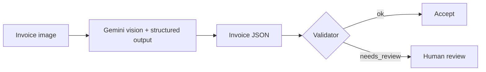

# Invoice Extractor

Arabic/English invoice image -> validated JSON, with an arithmetic validator and an evaluation harness.

## Problem
From 1 January 2027, companies in the UAE with AED 50 million or more in revenue must issue e-invoices, and smaller companies must follow from 1 July 2027.
Many companies still have large archives of paper and scanned invoices, many of them in Arabic or in both Arabic and English, and turning them into structured data by hand is slow and error-prone, especially for Arabic.

## Results
Evaluated on synthetic invoices generated by this repo; real-world accuracy is not measured yet.

Model: `gemini-flash-lite-latest`, 30 invoices (10 English, 10 Arabic, 10 mixed).

### Clean vs scanned invoices

| field            | clean | scanned | change     |
|------------------|-------|---------|------------|
| supplier_name    | 93%   | 97%     | +1 invoice |
| invoice_number   | 77%   | 83%     | +2 invoices |
| subtotal         | 97%   | 93%     | -1 invoice |
| total            | 100%  | 97%     | -1 invoice |
| fully correct    | 70%   | 73%     | +1 invoice |
| validator caught | 4/9   | 4/8     |            |
| false alarms     | 0/21  | 0/22    |            |

**Noise:** running the same scanned test twice with no change gave 22 and 21 fully correct invoices, so a difference of 1 invoice is noise. The clean vs scanned difference is within the noise: scanning did not change the accuracy.

### By language (fully correct)

| language | clean | scanned |
|----------|-------|---------|
| English  | 100%  | 100%    |
| Arabic   | 60%   | 60%     |
| mixed    | 50%   | 60%     |

### Main finding
The most common error is reading the Arabic-Indic digit ٢ (2) as ٣ (3): 16 to 22 times per run, while no other digit pair appears more than 3 times. Two prompt changes (a general one and one about ٢ and ٣) did not reduce it beyond the noise.

### Model comparison
I tried a second model, `gemini-3.8-flash`, but the Gemini free tier allows only 20 requests per day for this model, so 17 of 30 invoices failed. The comparison is not complete yet.

## How it works


1. An invoice image (PNG, JPG or WebP) is sent to the extractor.
2. Gemini reads the image and returns JSON that follows the Invoice schema.
3. The validator checks that the invoice is consistent: line totals, subtotal, 5% VAT, total and a 15-digit TRN.
4. If all checks pass, the invoice is accepted; if not, it is marked `needs_review` for a human.

## How to run
```bash
git clone https://github.com/Mohammad-Jaafar/invoice-extractor.git
cd invoice-extractor
uv sync
uv run playwright install chromium
cp .env.example .env
uv run python -m generator.generate --count 30
uv run python -m eval.run_eval --dir data/clean --limit 3
uv run python -m pytest -q
uv run fastapi dev app/main.py
```

After copying `.env.example` to `.env`, put your key in `GEMINI_API_KEY`. On Windows, use `Copy-Item .env.example .env` instead of `cp`.

## Limitations
1. All data is synthetic.
2. Invoices are generated from only two templates.
3. It does not issue official e-invoices (this is the job of accredited service providers).
4. The validator does not detect reading errors that do not break the math (for example a wrong invoice number).
5. Small sample: 30 invoices, with a noise of ±1 invoice.
6. Only one model was fully evaluated, because of the free tier limits.